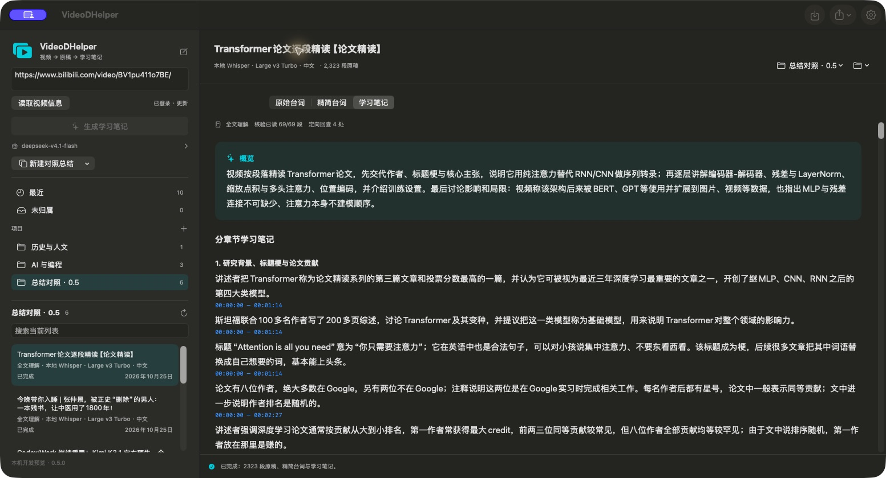
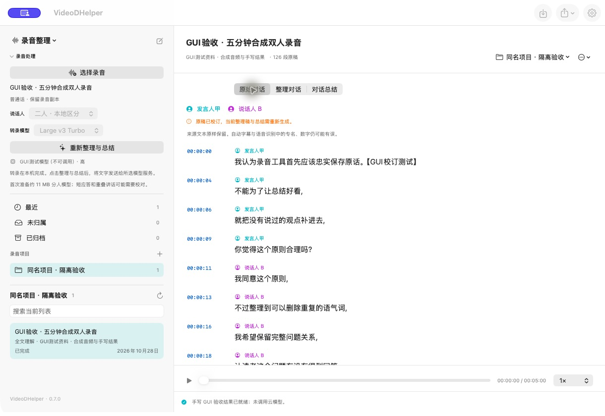
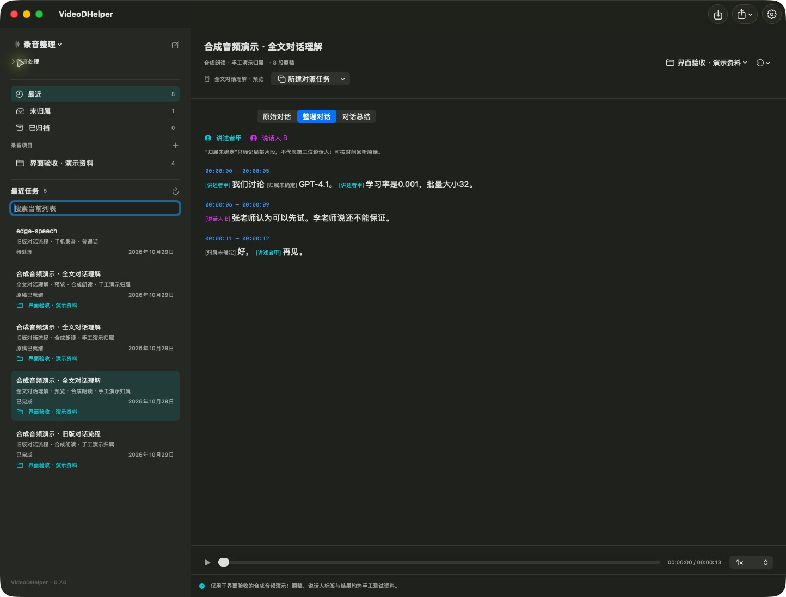
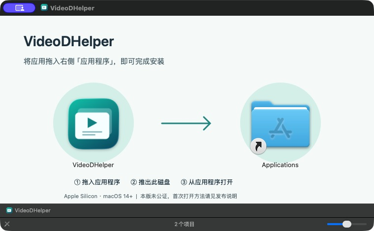
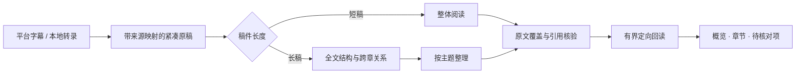
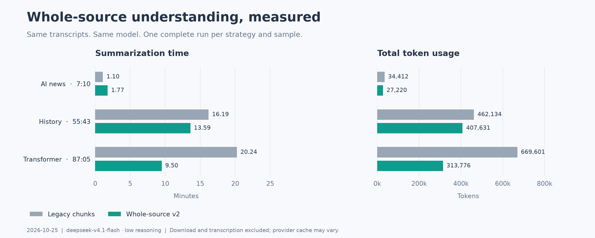

<div align="center">

# VideoDHelper

### 把看过的视频，变成能回看的知识。

原生 macOS 视频学习助手 · Bilibili → 原稿 → 精简台词 → 学习笔记

[](docs/building.md)
[](docs/user-guide.md#本地转录与模型)
[](https://github.com/ShallM/VideoDHelper/releases/tag/v0.6.0)
[](https://github.com/ShallM/VideoDHelper/actions/workflows/ci.yml)
[](LICENSE)

[下载 0.6.0 DMG](https://github.com/ShallM/VideoDHelper/releases/tag/v0.6.0) · [安装指南](docs/installing.md) · [开始使用](#开始使用) · [功能一览](#功能一览) · [录音开发预览](docs/recordings.md) · [使用指南](docs/user-guide.md) · [开发日志](CHANGELOG.md)

</div>



<p align="center"><sub>0.5.0 原生应用实拍。笔记内容用于展示整理能力，保留来源时间以便回看；不是外部事实核查。</sub></p>

> [!IMPORTANT]
> **0.6.0 提供独立 DMG：仅支持 Apple Silicon（M 系列），macOS 14+。** 内置 Python、MLX、yt-dlp 和 FFmpeg，拖入“应用程序”即可安装。**本版未公证**，首次打开可能需要按 [安装指南](docs/installing.md#本版未公证首次打开) 在系统设置中确认。模型权重首次使用时准备，API 由你自行配置。

> [!NOTE]
> **0.7.0 正在开发预览，尚未合并到 `main`，也未发布新 Release。** 新增详细会议纪要、独立原文证据检查、局部修订与有界回读。内容质量验收尚未通过，新建录音仍默认使用旧流程；新方案从“新建对照任务”主动选择。下方下载入口仍是 **0.6.0**；不要把开发预览功能与已发布 DMG 混淆。

## 0.7.0 开发预览

| 从哪里开始 | 本轮功能 |
|---|---|
| **左上角功能菜单** | 在“B站视频”和“录音整理”之间切换整页；各自拥有项目、最近、未归属和归档，任务不会混在一起。 |
| **导入手机录音** | 重点支持 M4A、MP3、WAV，普通话、两人对话，最长 50 分钟；保存本机副本，保留外部原文件。 |
| **先取得原话** | 本地 MLX / Metal 转录；Turbo、完整 Large-v3、Qwen3-ASR 1.7B + 时间对齐三组选项，可选 SpeakerKit 区分说话人 A / B。这个阶段不调用大语言模型。 |
| **管理本地模型** | 设置 → 语音转文字，主动下载、暂停续传、校验、删除及设置新任务默认。应用不含权重，B 站与录音共用资源；[管理指南](docs/local-asr-models.md)。 |
| **校对后再整理** | 改说话人姓名、校订单句、点时间回听；明确点击“整理与总结”后，才将文字交给模型，得到整理对话和总结。 |
| **会议纪要 · 预览** | 完整原稿先生成详细纪要，再独立提取关键证据，核对状态、条件和归属后局部修订；仅在有额外原文时有界回读。[工作流说明](docs/meeting-understanding-v3.md)。 |
| **连续阅读与明确行动** | 纪要先交付，原话连续排版；可单独优化断句与标点并展开局部归属。总结单列明确行动、前提与有证据的负责人和期限。 |
| **保留旧稿作对照** | “新建对照任务”复制原稿、校订和音频；可选会议流程、全文基线、上一版全文理解及旧流程，成果、检查点和用量独立。新结果成套保存，避免中断后混读两代文字。 |
| **模型与用量** | 每个模型保存思考强度；按 B 站视频、录音整理、连接测试筛选用量，保留手填价格和费用换算。 |

SpeakerKit 采用 **CPU 与 Apple Neural Engine 混合计算**，并非整条分人流程都运行在 GPU。额外模型在较新系统上约 11 MB，macOS 14 使用另一组约 15 MB 模型；与 Whisper 权重分别缓存。短应答、相似声音和重叠讲话仍需人工核对，合成测试不代表真人录音准确率。

使用步骤、恢复规则与已知边界见 **[录音整理指南](docs/recordings.md)**。本轮检查结果与剩余限制见[录音预览验收](docs/validation-recording-preview.md)；正式 Release 仍等待合并与发行验收。

本机预览已更新到 **build 31**。来源改由程序定位，一次格式修正保留原候选；固定对照中全文基线完成，新会议流程仍因字段类型校验停止。基线保留固定清单26/33项重要内容，不代表整体准确率，也不能证明新会议流程质量提升。新录音继续默认旧流程，完整结果、耗时与用量见[会议纪要验收](docs/validation-meeting-v3.md)。

三款本地语音模型的管理、真实录音中断恢复和离线安装包检查，见[ASR 模型管理验收](docs/validation-asr-manager.md)。三款均可运行和接入现有流程，不将单次样本表现作为准确率排名。

build 16 的[录音理解验收](docs/validation-dialogue-v2.md)分别记录运行、恢复与内容评阅。有限验证仍发现核验新增范围泛化、改变材料准备状态及条件遗漏等错误，因此保留旧流程作为新录音默认，不宣称新方案全面优于旧版。引用合法、格式正确、文字变短都不等于理解正确。B 站视频继续使用原有总结流程。

<details>
<summary>查看录音原稿与回听界面（开发预览）</summary>



界面来自隔离验收：合成普通话原稿与手工校订，不是用户录音，也不是模型总结质量演示。

</details>

<details>
<summary>查看“全文对话理解 · 预览”的整理界面</summary>



截图为隔离验收中的手工或合成测试资料，只展示交互，不作为模型总结效果证据。通过录音标题区“新建对照任务”选择“全文对话理解 · 预览”后，另点“整理与总结”开始。

</details>


## 功能一览

| | 你可以做什么 |
|---|---|
| **链接与下载** | 粘贴 B 站链接、短链接或完整分享文字；读取标题、时长和实际可用格式，选择清晰度、帧率、编码及 MP4 / MKV 封装。 |
| **字幕与转录** | 默认优先平台字幕，也可手动切换本地 Whisper。Apple Silicon 使用 MLX / Metal，优先复用已有模型。 |
| **三份文字** | 保留原始台词；按顺序生成精简台词；整理概览、自然章节、知识点和待核对内容。 |
| **全文理解** | 短稿整体阅读，长稿先建立全文结构，再按主题整理、核验来源与定向回读。旧版分块流程可另建对照。 |
| **来源可回看** | 每个知识点附时间入口；引用相隔较远的内容时，分别跳转各处原文。支持 Markdown、TXT、SRT 导出。 |
| **任务管理** | 最近、项目、未归属与搜索；支持新建、重命名项目及移动任务。取消或失败后可从已完成阶段继续。 |
| **模型与用量** | 多服务商、多模型、连接测试、手填价格表；统计输入、输出、推理、缓存命中及分阶段费用估算，支持 CSV。 |
| **本机存储** | 可选择完成后保留或清理媒体；只有文字成功保存后才清理。B 站会话留在本机，模型接口接收文字资料。 |

开发预览的归档、恢复与删除使用说明见[任务管理验收](docs/validation-task-lifecycle.md)。删除使用 macOS 废纸篓，并保留历史用量；当前 0.6.0 DMG 尚不包含这些管理入口。

## 开始使用

从 **[GitHub Release 下载 0.6.0 DMG](https://github.com/ShallM/VideoDHelper/releases/tag/v0.6.0)** → 打开 → 将 VideoDHelper 拖入 Applications → 复制完成后推出磁盘映像 → 从“应用程序”启动。



**无需 Homebrew 或开发工具。** 首次打开与未公证说明见 [安装指南](docs/installing.md)。需要自行构建或修改代码时，使用 [开发构建说明](docs/building.md)。

1. **配置模型** — 按 `⌘,` 打开设置，在“模型服务”填写 OpenAI 兼容的 Base URL、API Key 和模型 ID，测试并保存默认模型。
2. **放入视频** — 粘贴分享文字，点“读取视频信息”。需要账号权限时，在应用中完成 B 站登录。
3. **选择处理方式** — 保持字幕优先，或使用本地 Whisper；按需选择下载规格和是否保留媒体。
4. **生成与回看** — 点“生成学习笔记”，在三种阅读视图之间切换，用来源时间返回视频核对，或导出结果。

已有字幕文件也能从工具栏直接导入。完整说明见 [使用指南](docs/user-guide.md)；安装与升级见 [安装指南](docs/installing.md)，源码构建见 [构建说明](docs/building.md)。

## 长视频如何整理



紧凑原稿保留全部文字，字幕与时间映射存于本机。长稿先梳理主题、术语和跨章更正关系，后续核验回到原文，不只检查压缩摘要。定向回读只访问当前视频，最多两轮、六次；未解决的疑问继续保留。

每阶段保存检查点，成功结果经结构和来源校验后才落盘。恢复会复用已完成计算；供应商输入缓存与本机检查点命中分别统计。实现及预算说明见 [总结流程设计](docs/summarization-v2.md)。

## 实测：不只展示最好的一次



| 样本 | 旧版 → 新版耗时 | 旧版 → 新版总 Tokens |
|---|---:|---:|
| 7:10 · AI 资讯 | 66.2 → 106.4 秒 | 34,412 → 27,220 |
| 55:43 · 历史讲解 | 971.6 → 815.5 秒 | 462,134 → 407,631 |
| 87:05 · Transformer 精读 | 1,214.3 → 569.9 秒 | 669,601 → 313,776 |

测量日期为 2026-10-25，模型为 `deepseek-v4.1-flash`，推理强度 `low`。每个方案、每份样本各一次最终完整运行，从空本机总结检查点开始；**不含下载和转录**。平台缓存、负载和模型随机性影响结果，不能视作普遍性能承诺。

两份长稿更快且用量更少；短稿加入整稿核验后反而更慢。67 项主题清单中未发现整项主题缺失，但数字歧义、局部措辞和漏提醒仍存在，新流程并未在所有细节上胜过旧版。完整口径、失败重试、开发额外用量及已知退步均保留在 [0.5 验收报告](docs/validation-0.5.md)。

## 模型、隐私与费用

- 支持 **OpenAI 兼容 Chat Completions**，可设置服务商和模型；已验证积算平台 `deepseek-v4.1-flash`。不假定所有兼容服务支持相同参数。
- 音频转录在本机完成；标题、必要文字和来源编号会发送至你配置的模型服务。媒体和 B 站 Cookie 不发送给模型服务。
- 当前 API Key 存在权限为 `0600` 的本机配置文件中，**尚未接入 Keychain**。仓库不含密钥、Cookie、个人任务、媒体或模型权重。
- 手填普通输入、缓存输入和输出单价，支持每千 / 每百万 Tokens 换算及价格快照。费用是本机估算，未接入供应商账单或余额；未知用量不会按零计费。

详见 [设置、模型与计费](docs/settings-and-usage.md) 和 [数据与隐私](docs/privacy.md)。

## 文档地图

| 文档 | 内容 |
|---|---|
| [安装与升级](docs/installing.md) | DMG、首次打开、数据位置与校验和 |
| [使用指南](docs/user-guide.md) | 登录、下载选择、三种文字、项目、恢复与导出 |
| [录音整理（0.7.0 开发预览）](docs/recordings.md) | 两人录音、本地分人、人工校订、对话总结与恢复 |
| [录音文字理解设计（build 16）](docs/dialogue-understanding-design-2026-10-28.md) | 调研依据、全文总结与稀疏整理、原文核验、有界回读及兼容合同 |
| [录音理解验收](docs/validation-dialogue-v2.md) | 真实回归、质量限制、用量、恢复与原子成果读取 |
| [构建与开发](docs/building.md) | 环境、构建、测试、CI 产物、常见问题 |
| [版本日志](CHANGELOG.md) | 0.1 → 0.6 的功能和修复，以及 0.7.0 未发布改动 |
| [开发记录](docs/development-log.md) | 关键取舍、验证结论与下一阶段 |
| [任务管理验收（待发布）](docs/validation-task-lifecycle.md) | 归档、删除、项目联动、废纸篓恢复与计量保留 |
| [总结设计](docs/summarization-v2.md) · [技术调研](docs/summarization-research-2026-10-25.md) | 全文阅读、来源核验、有界回读与设计依据 |
| [0.2 验收](docs/validation-0.2.md) · [0.3 验收](docs/validation-0.3.md) · [0.4 验收](docs/validation-0.4.md) · [0.5 验收](docs/validation-0.5.md) · [0.6 安装验收](docs/validation-0.6.md) | 真实样本、用量口径、恢复和已知问题 |
| [需求与历史方案](docs/project-plan.md) · [下载器调研](docs/downloader-research.md) | 产品范围与技术选择背景 |

<details>
<summary><strong>目录结构与本地检查</strong></summary>

```text
Sources/VideoDHelper/     SwiftUI 应用、设置和阅读视图
Sources/VideoCore/        链接、字幕、任务、模型与计费
backend/                 下载、MLX 转录、总结、恢复与计量
Tests/                   Swift 测试与共享计量样本
backend/tests/           Python 测试（模拟 API，无付费调用）
scripts/                 构建、工具安装与验收脚本
docs/                    指南、设计、实测数据和图片
.github/workflows/       macOS 自动测试与开发构建
```

```sh
zsh scripts/swift-project.sh test
PYTHONPATH=backend .venv/bin/python -m unittest discover -s backend/tests -v
python3 scripts/check-publication.py
```

0.6 功能基线：43 项 Swift、53 项 Python 测试；任务管理开发分支增至 52 项 Swift 测试。CI 运行离线测试并构建开发 `.app`，不访问 B 站账号、不下载模型、不调用付费模型。贡献前请阅读 [贡献指南](CONTRIBUTING.md)。

</details>

## 当前边界与下一步

- 已测试普通投稿视频与单个分 P 链接；批量队列、合集、番剧和付费课程尚未逐项验收。
- 主要面向中文学习视频；最长完整实测 87:05。画面中的代码、公式、图表和关键帧尚未接入。
- 来源覆盖不等于语义正确；专名、数字、医疗或其他专业论断应回看来源。当前不做外部事实核查。
- 0.7.0 录音预览面向普通话二人对话；不做自动性别判断、真实身份识别或跨录音声纹库。多人会议、实时录音和手机同步暂不包含在首版。
- **分发限制：** 本版仅 arm64 / macOS 14+，未公证；本机实测为 M4 / macOS 26.6.2，尚未覆盖 macOS 14 真机与所有 M 系列。后续补充兼容性与 Developer ID 公证。

## 许可与致谢

项目原创代码采用 **[PolyForm Noncommercial 1.0.0](LICENSE)**。按条款允许非商业使用、修改和分发；商业用途需另行取得授权，条款列明的机构用途以原文为准。由于限制商业用途，本项目是 **source-available（源码可见）**，不称为 OSI 意义的开源。商业授权请通过 [维护者主页](https://github.com/ShallM) 联系。

第三方组件与原作者许可保持不变。感谢 [yt-dlp](https://github.com/yt-dlp/yt-dlp)、[FFmpeg](https://ffmpeg.org/)、[Whisper](https://github.com/openai/whisper) 与 [MLX](https://github.com/ml-explore/mlx-examples)；相关许可和设计参考见 [第三方说明](THIRD_PARTY_NOTICES.md)。本项目与 Bilibili 无官方关联。
