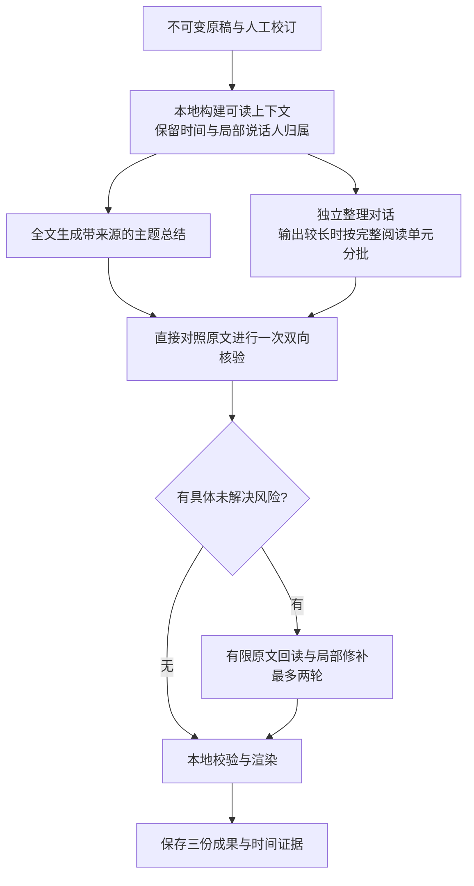

# 录音文字理解：调研与架构决策

调研开始于 2026-10-28，定稿于 2026-10-29。状态：**下一轮开发方案，尚未实现**。当前可运行应用为 0.7.0 build 15；该版交付三款 ASR 的管理与接入，文字理解仍是 `dialogue-reader-v1.1`。本文件在[上一轮质量复盘](recording-quality-plan-2026-10-28.md)基础上收紧实施范围，不把调研结论或换 ASR 当作已经取得的总结质量提升。

## 决策

采用 **全文优先、成果分离、原文核验、有限回读的确定性工作流**。继续使用现有 Python 编排和用户配置的大模型 API。模型只决定需要回读哪些原文及提出哪些有证据的修订，程序掌握阶段、范围、预算、停止与保存。

普通录音的主路径为：

这里的“一次核验”指一轮覆盖检查，长材料可包含多个有明确负责范围的请求；不是承诺任意长度都只发送一次 HTTP。回读不是外部联网核实，也不能替代听音确认。

首版不迁移到 LangGraph / CrewAI / AutoGen，不建立向量库或多模型投票服务。也不把独立的全量事实表设为必经阶段：先增强已有 `claims/source_ids`，让每条总结可以追查证据。只有简单主线仍有稳定失败反例时，再单独测试事实表是否值得加入。

这是面向现有系统的实施选择，**质量收益仍须对照验证，不能提前称为最优架构**。

## 为什么当前流程仍有问题

实际代码是原稿 → 紧凑段落 → 全文规划 → 逐章生成（同时生成总结和完整整理稿）→ 核验 → 回读 → 综合 → 终检。它已经有有限 agent 行为，但阶段数量不等于理解质量。

| 当前现象 | 已确认的实现原因 | 本轮要改变的合同 |
|---|---|---|
| 约 6,000 字的录音形成约 500 个阅读段 | `recording.align_speakers` 随标签变化切段，`summary_v2.paragraphs(dialogue=True)` 再按每次 A/B/unknown 变化断开 | 阅读单元可以包含局部归属不确定片段；保留底层标记，不把整句切成几次“发言” |
| 能放进输入预算的材料仍先规划十余章 | `Reader.run` 的全文路线门槛固定为 6,000 估算 Tokens，默认工作输入预算却是 48,000 | 按完整序列化请求、有效阅读预算及输出压力分别决定路线 |
| 整理稿碎行多，且可能长于原稿 | `validate_condensed` 要求逐段完整分区，每项必须单一说话人；章节请求同时负担长整理稿和主题总结 | 总结与整理稿分别生成；整理稿允许一行内保留局部归属标记 |
| 章节覆盖完整，仍可能漏条件 | 覆盖核验主要可验证编号范围，不能证明每条必要条件在成品里被保留 | 分开验收输入覆盖、事实保留和声明有据 |
| 已修订后又引入改写或重复疑点 | 核验后再次综合、终检；疑点主要按文本完全相同去重 | 核验输出稳定 ID 的补丁，按证据和问题身份管理疑点，最后由代码渲染 |
| 高思考阶段有时只有推理、没有正文 | 当前规划输出固定 16K，章节 12K；16K→32K→128K 扩容只用于核验 | 明确区分推理输出耗尽、正文截断与输入上下文超限，统一有界预算处理 |

新 ASR 的实录原稿已接入旧阅读器，Turbo / Large-v3 / Qwen 的阅读段分别仍有 **504 / 575 / 492** 个。这些是分段统计，不是准确率。原有低／高强度结果已发现条件遗漏、含混词确定化和对算法碎片的过度解释，具体私人证据仅留本机。

先前启动的旧 reader 实录对照还复现了两个执行问题：Large-v3 原稿在规划阶段耗尽输出、Turbo 原稿在第 14 章生成期间耗尽输出，均没有完整成品；Qwen 组完成章节后进入核验，因本轮转为架构调研而停止，保留 22 份检查点和一笔在途未知用量。这些诊断不能用于三模型质量排名，也不是新方案的实验成绩。本轮没有在失败后反复追加预算重跑。

## 开源产品：核实实际代码，而非照搬宣传

以下为本次读取的固定版本，不表示各项目所有路径或未来版本都一样；采用规模不能替代中文质量验收。

| 项目与证据 | 实际做法 | 采用与取舍 |
|---|---|---|
| [Meetily processor](https://github.com/Zackriya-Solutions/meetily/blob/a2cb62e827da7ef59f65064c97233efb2313878e/frontend/src-tauri/src/summary/processor.rs) | 云端与短稿主要全文生成；部分本地后端超过阈值才分块、合并。块失败后有限重试，仍失败则停止 | 采用容量判断和完整性保护。它的英文中间稿、再翻译、仅靠块摘要汇总不适合作为我们的默认中文流程 |
| [Anarlog / Hyprnote enhance](https://github.com/fastrepl/anarlog/blob/e35e79d14c8f7e41ddf3bd57b0251ab885f75f5a/apps/desktop/src/store/zustand/ai-task/task-configs/enhance-workflow.ts) | 全文转录、参与者、人工笔记和模板组合后生成；不是多 agent 协商 | 采用清楚区分原话、用户补充和输出任务。人工术语提示可后续加，首版不增加新表单 |
| [Anarlog 长度策略](https://github.com/fastrepl/anarlog/blob/e35e79d14c8f7e41ddf3bd57b0251ab885f75f5a/apps/desktop/src/services/enhancer/summary-length.ts)与[验证器](https://github.com/fastrepl/anarlog/blob/e35e79d14c8f7e41ddf3bd57b0251ab885f75f5a/apps/desktop/src/store/zustand/ai-task/task-configs/enhance-validator.ts) | 详细程度与成品长度分开定义；格式验证检查 Markdown 标题 | 采用具体的成品要求。标题合法不等于事实正确，仍保留我们的原文核验 |
| [Open Notebook Transformation](https://github.com/lfnovo/open-notebook/blob/a0f6f3081ae06328f0a451b3a3ef2959ca25721d/open_notebook/graphs/transformation.py)与[Ask](https://github.com/lfnovo/open-notebook/blob/a0f6f3081ae06328f0a451b3a3ef2959ca25721d/open_notebook/graphs/ask.py) | 单份已知材料是全文转换；跨资料问答才规划搜索、检索、综合 | 首次总结已知录音不需要先做向量检索；检索服务明确疑点即可。不能把框架使用等同于语义能力 |
| [Google LangExtract](https://github.com/google/langextract) | 结构化抽取映射回精确文字位置，长文可分块、多遍抽取 | 学来源锚定和引文检查；它是抽取工具，不是可以直接替换的会议总结器。匹配到原句仍不证明概括忠实 |

具体社区问题也改变了设计，而不只是提供“经验帖”：

- Meetily [#602](https://github.com/Zackriya-Solutions/meetily/issues/602)及修复 [#603](https://github.com/Zackriya-Solutions/meetily/pull/603)：按句边界缩短块，却按旧窗口位置推进，会静默漏掉输入。我们将“负责区间完整覆盖”保留为代码强校验，与语义完整性分别计分。
- Open Notebook [#1221](https://github.com/lfnovo/open-notebook/issues/1221)：非英语输出曾因固定输出上限截断，HTTP 200 仍不足以证明完成。我们检查结束原因、正文与结构，不照抄别人的 Token 数值。
- LangExtract [#201](https://github.com/google/langextract/issues/201)是已关闭的中文定位问题；[#565](https://github.com/google/langextract/issues/565)是已修复的空抽取缺少锚点问题。它们提醒我们用实际中文测试、拒绝空证据，不把历史 bug 写成项目当前缺陷。
- LangExtract [#303](https://github.com/google/langextract/issues/303)有人报告 reasoning 模型多次消耗后仍无结果；这是个案，不能据此判断某模型家族。我们的实际运行也出现过纯推理耗尽，因此要单独处理这类失败，避免自动转向越来越细的输入块。

## 原理依据及适用边界

| 来源 | 可用的依据 | 不能据此推出的结论 |
|---|---|---|
| [Anthropic：Building effective agents](https://www.anthropic.com/research/building-effective-agents)及[上下文工程](https://www.anthropic.com/research/effective-context-engineering-for-ai-agents) | 固定 workflow 与自主 agent 有区别；优先简单、可组合流程，明确工具职责与上下文 | 更多角色、更长提示词或更大上下文必然更准 |
| [LangGraph 工作流](https://docs.langchain.com/oss/python/langgraph/workflows-agents)与[持久化](https://docs.langchain.com/oss/python/langgraph/persistence) | 显式阶段、状态、检查点及恢复有工程价值 | 将现有恢复机制迁进框架便能提高语义质量 |
| [QMSum](https://aclanthology.org/2021.naacl-main.472/)与[ExplainMeetSum](https://aclanthology.org/2023.acl-long.731/) | 查询型会议总结应定位相关发言，摘要与支持证据可以分别评价 | 只检索 Top-K 就能覆盖整场讨论；出现引用就算忠实 |
| [Chain-of-Verification](https://aclanthology.org/2024.findings-acl.212/) | 独立回答核验问题能减少被初稿预设带偏 | 它已经证明我们的中文 ASR 对话能获得同样收益 |
| [BooookScore](https://arxiv.org/abs/2310.00785)与[Chain-of-Key](https://aclanthology.org/2024.findings-emnlp.220/) | 长书的层级、递增、结构记忆各有取舍；结构化记录值得做对照 | 中等长度录音也必须先建全量事实表；论文增益可直接移植。Chain-of-Key 实验使用 SUMIE／书籍及较小上下文，作者明确未评估生成信息的冗余与准确性 |
| [FineSurE](https://aclanthology.org/2024.acl-long.51/)、[DIASUMFACT](https://aclanthology.org/2023.acl-long.377/)、[MSumBench](https://aclanthology.org/2025.acl-long.702/) | 应分别检查忠实、完整、简洁及具体对话错误；评估表现受语言和领域影响 | 单一“质量分”或生成模型自评可替代人工校准 |

这些来源共同支持保留证据、控制步骤与认真评测，但**不能替我们选出未经实验的赢家**。因此没有把独立事实表、多 agent 互审或递归摘要列为默认必选项。

## 运行合同

### 1. 阅读单元与说话人

新增派生的阅读单元，不修改原 ASR、词时间、人工校订或原 SRT。它按原 ASR 句子、标点、停顿和清楚的换人边界组织完整上下文；可包含 `parts`，记录各部分的原始 source ID、字符范围和 A/B/unknown。

例如原句被对齐切成 unknown 一个字、A 一个字时，模型应看到完整文字及局部归属信息，而不是被暗示发生了两次独立发言。unknown 不等于第三个人，也不因左右同为 A 就自动归 A。真正的短答、否定、打断和重叠保留，不能为降低碎行数删除它们。

整理稿也需要新的轻量片段表示：一条可读行可以包含局部“归属未确定”。这涉及现有整理视图与 TXT/Markdown 渲染的小范围联动；若只改输入而保留“每行只能有一个标签”的合同，就不能声称已经修复碎行。原始对话与 SRT 继续使用原时间数据。

### 2. 全文总结与整理稿分别生成

总结：优先完整阅读后，按主题呈现双方观点、问答、条件、共识或分歧、明确下一步。没有共识或行动项时不凑栏目。每条实质结论绑定来源；必要的条件和否定留在结论本身，不能只藏在引用里。

整理稿：保留对话顺序、第一／第二人称、疑问与语气，去口头重复；不把每个残字扩写成解释。它不负责生成主题概览。输出量大时可以分批，但每批带相邻完整上下文，只有自己的负责范围允许产出，避免重复或缺尾。

**长整理稿需要分批，不代表总结必须分批阅读原文。** 取消当前把两种产物绑在同一次章节输出里的做法。新整理结果对每个来源片段记录保留、合并或仅去除填充内容的处理去向，但不要求每一段独占一行；这个映射只保证可追查，不能证明没有漏语义。

### 3. 输入与输出预算分开

删除对话路线的固定 6K 全文门槛。以系统提示、完整原文、草稿等实际序列化输入为单位计算预算；初版保留当前 48K 作为应用工作预算上限，再用实际 usage 校准估算。它不是供应商已承诺的上下文长度。

有已确认的模型上下文上限时，应同时扣除输出预留和安全余量；未知时不从模型名称猜测上限。先用当前实录验证，再扩大输入范围。`reasoning_effort` 遵从用户设置，不静默降低。

高强度输出预算的初始候选为 32K，必要时同一阶段最多一次升到已验证可用的 128K；具体值是待测工程参数，不是最佳值声明，也不能推广到其他服务商。输入超限、正文截断、纯推理耗尽、结构错误、网络超时分别记录：

此前验证的是该服务在特定输入下接受 128K 输出上限，不代表 48K 输入与 128K 输出预留可以同时使用；组合预算仍需按接口能力确认。

当前服务使用 `reasoning_effort` 与共享的 `max_tokens`；我们不能假装已有分别控制正文额度与思考额度的 API。所谓分别处理，是区分失败原因和调度方式，并观察返回的推理用量。

- 输入超限才缩小阅读范围，按完整单元分层；
- 整理稿正文截断只调整该批输出规模或预算；
- 纯推理耗尽不继续细切原稿，保留失败预算和成功阶段；
- 结构错误沿用一次受约束修复，不能循环改写到“通过”；
- 超时保留未知用量，不自动重复发送在途请求。

当全稿确实超过可靠阅读预算时，复用分层执行能力：每个自然范围保存带原文证据的局部声明、条件、更正和未答问题，再组织全局结果；跨段疑点可回读原文。中间摘要不成为后续唯一证据，也不引入向量数据库。输入区间完整性由程序验证。

### 4. 一轮双向核验与最多两轮回读

核验直接得到原文和两类草稿，不只看初稿生成的地图或事实表。先从原文查漏重要条件／结论，再逐条查成品有无依据、否定翻转、数字改写、错误归属或虚构共识。长输入的这一轮按范围覆盖，并补查跨范围关系。

模型的权限只有提出原文读取请求和带证据的结果补丁。继续使用兼容 API 的 JSON 协议，不要求服务商新增 function calling 能力。

“独立核验”指新的无生成历史请求直接读原文，不继承生成阶段的推理或计划；仍使用用户选择的同一模型，不冒称为独立评估模型。上下文隔离不能消除同模型的相关错误，也不直接等同于论文中的 factored 实验设置。

- 工具面只需要读取指定来源范围，以及在本任务内按字面词查找附近完整上下文；返回相邻阅读单元，必要时继续读取远处相关发言，不能只返回命中词。字面检索不承诺自动识别全部远距离问答。
- 回读问题保持中性，如“这个承诺有哪些前提”，避免“证明双方已经同意”。尽量先给原文与问题，再核对受影响声明。
- 最多两轮，每轮最多三个合并后的高风险问题；总计六项是初始上限，不是越多越好。
- 无新证据、重复问题、只有文风建议时停止。真实听不清的词保留待回听；LLM 不能自己确认 ASR 正误。
- 修订采用统一 `target_kind + target_id` 和证据范围：总结对应稳定 `claim_id`，整理稿对应稳定 `dialogue_row_id / part_id`。校验合法后直接应用。最后用代码生成 Markdown／界面，不再为了润色整体重写一次。
- 疑点记录类型、涉及命题与证据身份，以及未解决／已解决／需听音状态；程序精确合并同证据同类型，语义近似项由核验提出合并并保留证据，不用又一次无界去重模型调用。

本地验证拒绝空引文、非法范围、无来源的补丁，以及对结构化 speaker 字段／span 的未经确认改写。正文叙述中的归属错误仍需原文核验与语义评测，格式检查无法保证。需要精确引文时用同一规范的 Unicode 字符范围定位；中文标点、简繁与空白不能被“模糊匹配成功”掩盖。引文存在仍只是必要条件，语义支持另行检查。

## 最小改造范围与兼容

| 部分 | 做法 |
|---|---|
| 原稿 / ASR / 说话人引擎 | 继续复用；先改善阅读表示，不更换 SpeakerKit，也不让 LLM 猜人 |
| 阅读适配 | 新增一个小模块生成阅读单元、混合归属片段和来源映射 |
| 对话理解 | 计划用 `dialogue_context.py` 与 `dialogue_reader.py` 两个主要模块承载输入适配和录音流程；原 `summary_v2.py` 保留作旧流程和视频基线 |
| 协议与验证 | 新对话结果版本、稳定声明／疑点 ID、局部修订校验；尽量继续产出已有 notes 字段 |
| Swift 与导出 | 在现有整理对话视图支持可选的局部归属片段；保持现有三标签、时间跳转与姓名显示映射 |
| 共用基础 | 原 `ChatClient`、模型服务／强度、用量与价格、取消、磁盘持久化、任务资料库继续共用 |
| 缓存身份 | 含原稿与校订摘要、相关词时间及分人轨摘要、阅读适配版本、对话策略／提示词／输出 schema 版本、模型与强度、关键预算和阶段输入摘要 |
| 旧任务与恢复 | 任务保存 `dialogueStrategy`；缺字段的旧请求继续旧版。新方案另存对照、使用 `checkpoints/dialogue-v2/`，不覆盖原成果或混用检查点。取消旧生成后禁止覆盖新一代结果 |

B 站与录音共享基础能力，但技术视频的教学结构与二人对话的归属规则应各自有提示与输出合同。首先在录音验证；视频页不跟着改版，也不在没有回归结果时切换已有视频策略。

## 证明改善的方式

第一组是当前流程；第二组是可读上下文＋全文总结／独立整理稿＋一次原文核验；第三组在第二组上加入有限风险回读。第二组相对第一组是完整改造对照，不能把收益单独归因于某一个组件；第三组才隔离回读增益。独立全量事实表只作为必要时的第四组，不阻塞主线。

固定 ASR 输入、说话人信息、云端模型、思考强度和相近成品长度。先用确定性中文对话样例覆盖条件、否定、撤回、数字、小数、短答、未知归属和单方自称共识；再评当前真人录音。原稿不是人工金标准，音频质量和文本理解质量分开计分。

保留 30–50 条可定位的重要事实与关系核对表，标明候选／人工确认状态；未确认的录音事实不用于宣称真实准确率。利用 [VCSum 官方中文会议样本](https://github.com/hahahawu/VCSum)补充独立保留文本，避免只针对一份录音调参；公开会议文本不能代替手机录音噪声和说话人错误测试。

入围方案至少重复三次、交换展示顺序。逐条记录忠实性、重要事实保留、归属／否定／条件错误、重复和可读性；同时记录完整耗时、调用数、已知用量、未知费用及恢复结果。LLM 评分只作辅助，参考 [Anthropic 的评测实践](https://www.anthropic.com/research/demystifying-evals-for-ai-agents)，不能由生成模型给自己签发合格证明。

进入默认流程前应关闭既有重要反例，不能出现已知新增的关键事实错误；重要事实保留不低于基线，95% 只作为已确认参考范围的目标，并公开分母与漏项。引用全覆盖、调用成功、格式正确和篇幅更长均不单独算质量提升。

实施顺序确定为：**阅读表示与最小基线 → 总结／整理分离及预算处理 → 双向核验和有界回读 → 真人／保留样本对照 → 本机预览与 PR**。每步保留原结果，验证后再扩大范围；最后仍等待维护者确认合并与发行。
