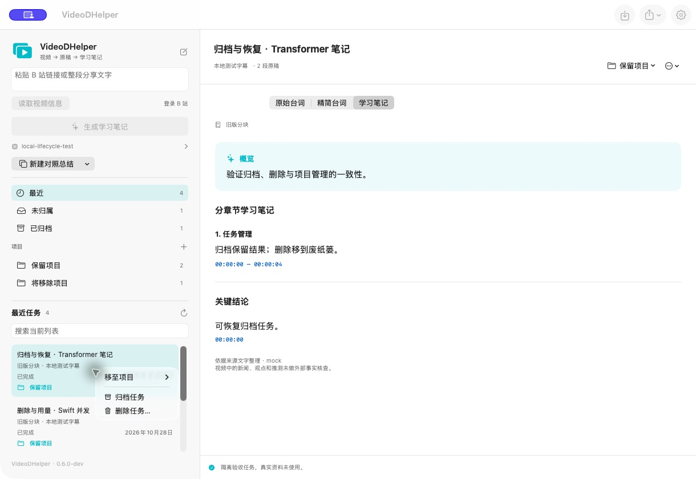
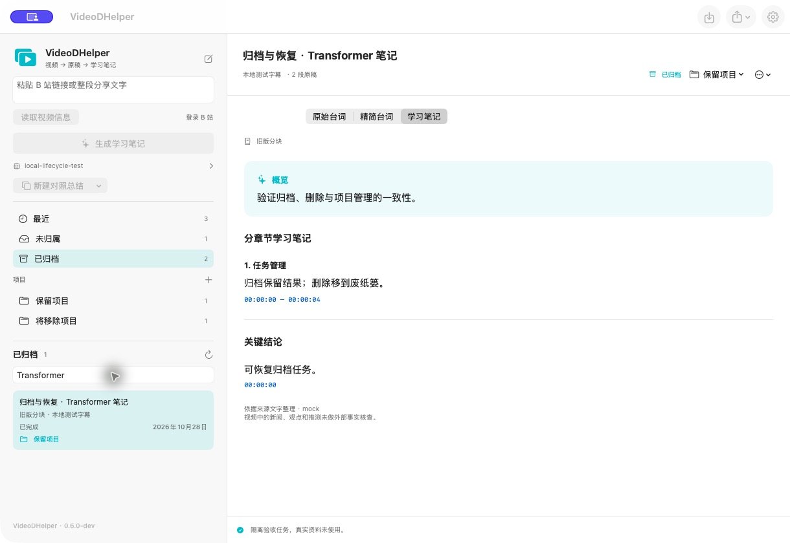

# 任务归档与删除验收（待发布）

2026-10-28，`codex/task-archive-delete` 开发分支。验证环境为 Apple M4、arm64、macOS 26.6.2。当前已发布的 0.6.0 DMG 不包含此次功能，本次不更新版本标签或安装包。

## 行为与入口

任务右键菜单与阅读区标题旁的“任务操作”提供归档、恢复和删除入口。“已归档”独立展示并支持搜索；最近、未归属和项目列表只统计未归档任务。

*开发构建实拍，使用合成任务、原稿和笔记，不含个人视频资料。*

归档保留原稿、结果、媒体、检查点和项目归属；恢复后打开原项目，原项目被移除时回到未归属。归档期间可阅读和导出，继续处理或另建对照前需要恢复。

删除前确认文件范围，使用 `FileManager.trashItem` 将整个任务目录移到 macOS 废纸篓。历史用量、价格快照和任务标题独立保留。Finder“放回原处”后刷新应用，任务回到未归属。另行导出的文件、导入字幕源文件、模型与其他任务不在删除范围内。

## 自动检查

| 检查 | 结果 |
| --- | --- |
| `zsh scripts/swift-project.sh test` | 52 项通过；本次新增 9 项 |
| Python 离线测试 | 53 项通过，未调用外部模型服务 |
| `zsh scripts/build-app.sh` | Release 配置的开发应用构建成功 |

新增测试覆盖：

- 旧目录没有归档字段时兼容读取；归档状态与项目归属经保存、重载后保持。
- 列表过滤、大小写搜索、项目重命名和移除后的恢复行为。
- 活跃工作进程持锁时拒绝归档和删除；无活跃锁的遗留“处理中”任务可以管理。
- 整个任务目录移走、其他任务保留、项目与归档索引清理。
- 移入废纸篓失败时保留任务；移动后目录提交失败时将任务放回。
- 损坏的目录、旧版计量、无效任务编号和符号链接不能触发误删。
- 新旧用量合并去重，删除、恢复、再次删除前后 CSV 内容一致，包括缓存用量与历史计价。

自动测试通过注入临时目录移动操作验证删除与回滚，不操作用户的系统废纸篓。真实废纸篓行为另外通过下面的 GUI 验收。

## macOS 界面与文件验收

测试应用使用独立 bundle ID、`VIDEOHELPER_DATA_DIRECTORY` 和五个合成任务，模型服务仅连接本机模拟端点。没有修改已安装的发行应用，也没有使用真实 API Key、B 站会话或付费请求。

| 操作 | 实测结果 |
| --- | --- |
| 归档当前任务 | 最近与项目计数减少、归档计数增加，阅读区切换下一条 |
| 搜索与重启 | 已归档列表可搜索；退出再启动后状态保留，默认打开未归档任务 |
| 从归档恢复 | 返回原项目并打开已有结果 |
| 移除含归档任务的项目 | 归档状态保留，恢复后进入未归属 |
| 删除确认中取消 | 任务及阅读内容保留 |
| 删除搜索结果的最后一条 | 列表归零，阅读区清空，导出入口禁用 |
| 确认删除 | 原目录消失，废纸篓中保留原稿、笔记、检查点和测试媒体；独立计量副本存在 |
| Finder“放回原处” | 整个文件夹回到原路径；刷新后任务出现在未归属 |
| 归档结果导出 | 保存 Markdown 成功，文件内容与已保存笔记一致 |
| 从归档列表新建 | 切回最近列表，清空阅读区与搜索 |
| 请求处理中 | 归档、删除禁用；取消完成后可正常归档 |
| 退出 | 测试应用正常结束，退出码为 0 |
| 真实资料隔离 | 测试前后真实项目目录和任务记录共 11 个文件的 SHA-256 一致 |

## 范围与发布前复核

本次验证任务管理与计量保留，没有重新运行长视频下载、转录或 AI 质量评测，因为相关算法未改动。删除不等于释放永久存储空间；系统废纸篓仍持有文件，清空后应用无法恢复。废纸篓恢复不保留原项目与归档归属，适合保留归属的任务应使用归档。

本机实测覆盖外置卷上的任务目录与 Finder 恢复。尚未重新制作完整 DMG，也未扩展到其他 M 系列芯片及 macOS 14 真机。发布时仍需针对最终提交完成发行构建、安装和签名验证。

原始日志、隔离测试目录和截图源文件保留在被 Git 忽略的 `local-data/task-lifecycle-validation/`，公开仓库只保留本报告及合成资料截图。
