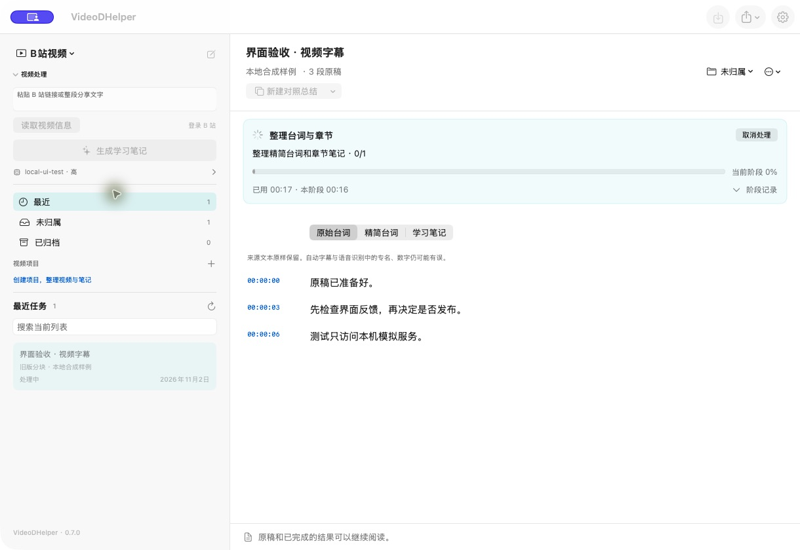

# build 33：运行反馈与阅读性能

本轮只改运行反馈、阅读布局和局部渲染性能。模型、提示词、预算、检查点身份与新录音默认策略沿用 build 32；不重新进行真实付费的内容质量对照。

## 使用方式

开始处理后，标题下方显示当前阶段、具体动作、总耗时和本阶段耗时。「阶段记录」展开最近 12 个阶段的起始时间，时间从本次启动或恢复计算。记录只属于当前会话；磁盘上的任务、检查点与诊断仍按原机制保存。

后台给出进度时显示「当前阶段百分比」；否则显示等待动画与计时，不估算整体百分比或剩余时间。纪要分别显示草稿、独立证据、核验和保存；共享的自动修正提示不会把证据或核验阶段误标为重新生成草稿。

取消后按钮进入收尾状态，晚到事件不能覆盖取消提示。完成或取消后显示本次用时。失败原因留在底部，可选中复制或点击「查看详情」重新打开。处理中仍可阅读和导出已有原稿。

标题区减少上下留白，来源和状态文字使用 13 pt；正文沿用用户设置，宽屏阅读列最多 920 pt。播放按钮扩大可点击区域，时间文字保持固定宽度。

## 检查范围

- Swift：94 项通过，包括未知进度、阶段重试、取消后晚到事件、耗时冻结、有限日志和稀疏引用索引。
- Python：235 项通过，包括会议阶段事件顺序、既有检查点恢复、字段协议及 B 站流程回归。
- 界面使用 `scripts/ui-feedback-fixture.py`：合成文本、隔离数据目录、本机模拟 HTTP，每次响应延迟 18 秒；没有真实 API 调用。
- 会议任务显示草稿→独立证据→核验；取消后从核验继续，草稿和证据耗时各约 1 毫秒，复用保存结果。中断时已发出的模拟请求不等于已保存阶段，本轮未宣称网络取消可以撤销服务端处理。
- 模拟 401 后显示具体原因；关闭后底部原因和「查看详情」仍可用。
- 视频字幕页面显示真实阶段进度，既有原稿可继续阅读。
- 自包含候选包、安装副本和正常退出检查在交付前补记。

## 性能测量

Release 优化编译，合成原稿 1,000 / 10,000 段，1,000 处引用、每处 8 个编号，重复 10 次。两种实现得到的时间范围完全一致。

| 原稿段数 | 旧线性查找总耗时 | 索引查询总耗时 | 建立索引一次 |
|---:|---:|---:|---:|
| 1,000 | 32.17 ms | 0.99 ms | 0.12 ms |
| 10,000 | 207.74 ms | 0.77 ms | 0.26 ms |

这是引用计算的局部基准，不是整页帧率或模型处理提速。每份原稿变化后重建索引；原稿读取、校订和切换任务均更新索引。AVPlayer 原先每 0.25 秒无条件发布时长/状态，现在值改变才发布；每秒计时由独立子视图更新。没有改变推理过程，也没有以短时观察宣称不存在任何内存泄漏。

设计参考 Apple 的[进度反馈指引](https://developer.apple.com/design/human-interface-guidelines/progress-indicators)和 [SwiftUI 性能说明](https://developer.apple.com/documentation/xcode/understanding-and-improving-swiftui-performance)，采用已有 SwiftUI 组件，不增加 UI 库或后台轮询服务。
